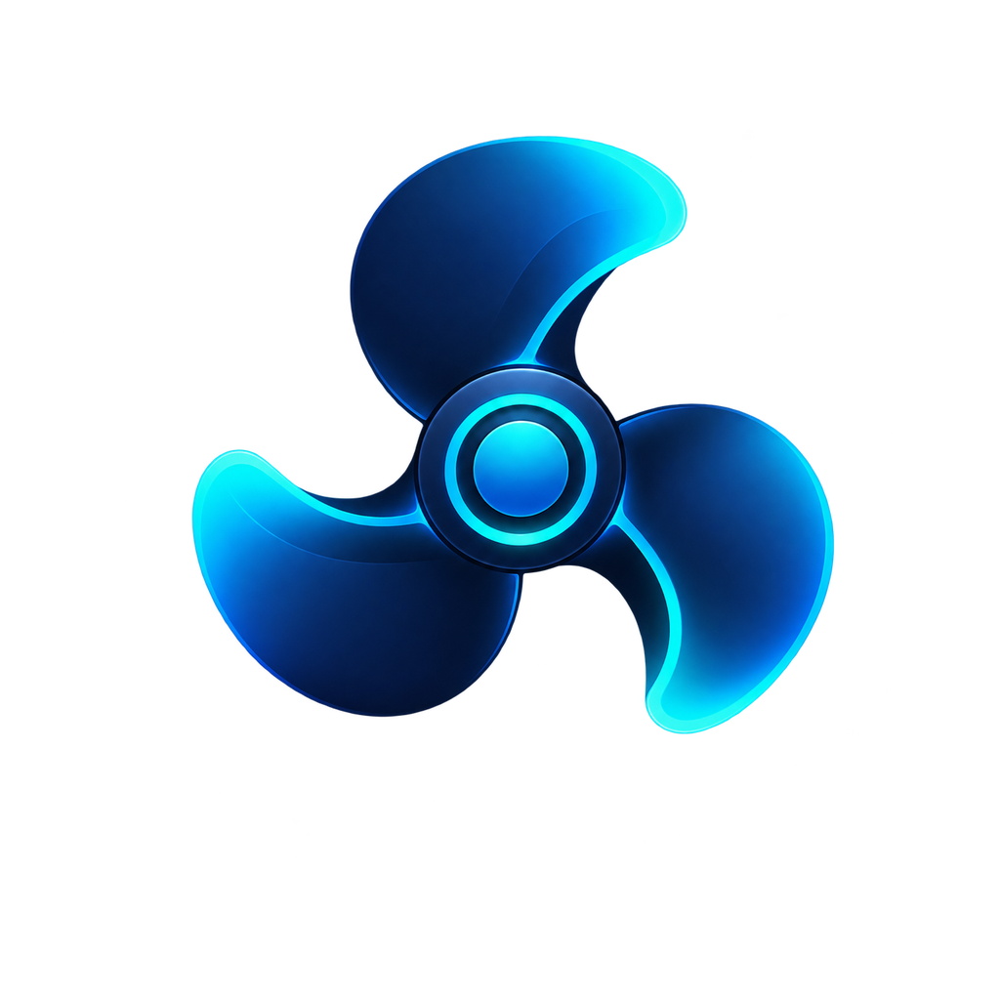

<div align="center">
  
  <h1>YogaFan G8</h1>
  <p>A focused Windows fan-control utility for the Lenovo Yoga Pro 9 14IRP8 (machine type 83BU).</p>
</div>

> [!WARNING]
> YogaFan G8 writes to the laptop's embedded controller (EC). A wrong protocol,
> interrupted transaction, incompatible model, or blocked kernel driver can
> destabilize Windows or the hardware. The application rejects unsupported
> machine types, but that is not a hardware-level guarantee. Read the safety
> section before using real fan control.

## Contents

- [What YogaFan G8 does](#what-yogafan-g8-does)
- [Supported hardware](#supported-hardware)
- [Install and update](#install-and-update)
- [Using the application](#using-the-application)
- [Safety model](#safety-model)
- [Settings explained](#settings-explained)
- [Telemetry and logs](#telemetry-and-logs)
- [Run from source](#run-from-source)
- [Build a Windows package](#build-a-windows-package)
- [Troubleshooting](#troubleshooting)
- [Project structure](#project-structure)
- [License](#license)

## What YogaFan G8 does

YogaFan G8 combines Lenovo's automatic fan policy with carefully bounded manual
and curve-based controls in a dark, responsive PySide6 interface.

- **Lenovo Auto** returns fan ownership to Lenovo firmware.
- **Manual** controls both fans from 1800 to 5300 RPM in 100-RPM steps.
- **Fan Curves** provides Quiet, Balanced, Performance, and independent custom
  CPU/GPU curves.
- Live cards show CPU temperature, GPU temperature, Lenovo Fn+Q mode, current
  fan RPM, connection state, and Safety Service state.
- The fan graphics, cyan progress rings, and numeric RPM values are driven by
  measured tachometer data. A slider target never pretends that a fan has
  already reached that speed.
- Optional CSV logging records telemetry and application events without blocking
  the UI.
- Closing the window can keep monitoring active in the Windows system tray.


### Important control behavior

When switching from Lenovo Auto to Manual, the sliders pick up from the current
measured fan RPM instead of restoring an old high target. With **Link Fans** on,
one shared rounded value is used. With it off, each fan starts from its own
measured RPM. No stale saved target is pushed during this transition.

Custom curve edits are staged. They affect live control only after **Apply
Curve** is pressed. Invalid rows are highlighted, RPM values snap to 100-RPM
steps, and **Reset to Default** restores:

| Temperature | Target |
|---:|---:|
| 50 °C | 2400 RPM |
| 60 °C | 3000 RPM |
| 70 °C | 3600 RPM |
| 80 °C | 4300 RPM |
| 85 °C | 4800 RPM |
| 90 °C | 5300 RPM |

Curve increases are applied immediately. A lower request must remain stable for
10 seconds before the target is reduced, which avoids rapid up/down oscillation.

## Supported hardware

The real hardware path is restricted to:

| Requirement | Supported value |
|---|---|
| Operating system | Windows 11 x64 |
| Laptop | Lenovo Yoga Pro 9 14IRP8 Gen 8 |
| SMBIOS machine type | `83BU` |
| EC protocol | confirmed `0x6C` / `0x68` Gen 8 protocol |
| Manual target range | 1800–5300 RPM, 100-RPM steps |

Gen 9, Gen 10, other Yoga models, and machine types that merely look similar are
not supported. YogaFan G8 checks SMBIOS before the Safety Service initializes
hardware and fails closed when the device does not match.

FCMO/Fn+Q mode is display-only. YogaFan G8 does not write Lenovo's mode register
or replace the firmware power-mode implementation.

## Install and update

YogaFan G8 is a portable folder application; there is no installer yet.

### Download from GitHub

1. Open the [latest release](https://github.com/z15dv/yogafan-g8/releases/latest).
2. Under **Assets**, download `YogaFanG8-Windows-x64.zip`.
3. Right-click the ZIP and select **Extract All**.
4. Open the extracted `YogaFanG8` folder and start `YogaFanG8.exe`.

Keep the complete extracted folder together; the EXE needs its `_internal`
folder. On the first launch, choose **Set up and start** and approve the normal
Windows UAC prompt for the separate Safety Service helper.

### Update

1. Open the tray menu and choose **Exit**. Do not update while manual or curve
   control is active.
2. Download and extract the newest release ZIP.
3. Replace the old YogaFan G8 folder, then start `YogaFanG8.exe` again.

The current build enforces one GUI instance per Windows user. Starting the app
again while it is hidden in the tray brings the existing window to the front
instead of opening another GUI or creating additional tray icons.

## Using the application

### Lenovo Auto

Lenovo firmware controls both fans. Sliders are informational and disabled.
Use this mode before closing the application for maintenance or before testing
another fan utility.

### Manual

Select **Manual**, then drag or click a slider. Values are snapped to 100-RPM
steps and remain within 1800–5300 RPM. **Link Fans** mirrors a committed target
to both fans; disabling it allows independent targets.

The app distinguishes target RPM from actual RPM. Physical fan acceleration can
lag behind a target change, and the UI continues showing the measured value.

### Fan Curves

Quiet, Balanced, and Performance are built-in CPU/GPU-aware profiles. Custom
contains separate CPU and GPU tables; the greater cooling demand drives the
fans. Editing is safe to explore because live targets do not change until
**Apply Curve** succeeds.

### System tray and background operation

**Run in background when the window is closed** is enabled by default:

- X hides the window.
- Live telemetry, safety monitoring, and the current control mode continue.
- Double-clicking the tray icon, choosing **Open YogaFan G8**, or starting the
  EXE again restores the same window.
- Choosing **Exit** stops the GUI worker and requests Lenovo Auto through the
  bounded shutdown path.

If the setting is disabled, X performs the same complete exit instead of hiding.

## Safety model

YogaFan G8 separates the ordinary UI from a small elevated Safety Service:

```text
Unprivileged PySide6 GUI
        │ authenticated local pipe + heartbeat
        ▼
Elevated Safety Service
        │ strict command allow-list and model check
        ▼
WinRing0 backend → Lenovo Gen 8 EC
```

The Safety Service owns the hardware connection, accepts one GUI lease, checks
heartbeats, validates every target, and attempts Lenovo Auto Restore after a
disconnect or critical condition. The GUI never silently falls back to direct
EC access.

Additional safeguards include:

- exact `83BU` compatibility gate before backend creation;
- finite waits and one serialized EC transaction lock;
- manual values restricted to 1800–5300 RPM;
- no Fan Off control;
- FCMO/Fn+Q register is read-only;
- authenticated IPC and restricted key/pipe ACLs;
- automatic protection enabled by default;
- command invalidation after a protection latch;
- mock-only automated tests and a packaged mock self-test.

### Thermal protection

Automatic thermal protection is on by default:

| Sensor | Default | Configurable range |
|---|---:|---:|
| CPU | 95 °C | 90–100 °C |
| GPU | 85 °C | 80–90 °C |

At the configured limit YogaFan G8 requests confirmed **Lenovo Auto** and latches
custom control. It does **not** shut down Windows. Lenovo firmware and Windows
may independently throttle or shut down the system under their own policies.

Changing a limit or disabling the handoff requires a risk confirmation. If
disabled, the UI keeps a persistent warning visible. Disabling this feature does
not disable firmware-level or Windows-level protection; it only disables this
application's automatic Auto Restore at the chosen temperature.

### Driver warning

WinRing0 is a known vulnerable kernel driver and may be blocked by Microsoft
Defender, Core Isolation, or another security product. YogaFan G8 does not
disable Windows security, add antivirus exclusions, or bypass driver warnings.
If Windows blocks the driver, the application remains fail-closed and real fan
control is unavailable.

No software-only design can guarantee recovery during a BSOD, power loss, EC
firmware failure, or severe hardware fault. The Safety Service is an additional
layer, not a hardware failsafe.

## Settings explained

### Link Fans

When enabled, one committed manual target is used for both fans. When disabled,
Fan 1 and Fan 2 can be adjusted independently.

### Run in background

Enabled by default. X hides the window and monitoring continues in the tray.
Disable it when X should stop the UI and restore Lenovo Auto.

### Power-aware NVIDIA fallback

The EC temperature is preferred. If the EC GPU sensor is unavailable, the
optional NVML fallback can query the NVIDIA GPU. It is lazy and throttled to
reduce unnecessary wake-ups of a sleeping discrete GPU. Disable it if preserving
dGPU sleep is more important than showing a fallback GPU temperature.

### Windows temperature notifications

Enabled by default. Disable this setting to suppress Windows popup notifications
for high CPU or GPU temperatures. The in-app warning state and automatic thermal
protection remain active. Notification rearming also uses a small temperature
hysteresis so readings fluctuating directly around a threshold do not repeatedly
trigger the same popup.

### Automatic thermal protection

Controls the YogaFan-specific temperature-triggered Lenovo Auto handoff described
above. The safe default is enabled at 95 °C CPU / 85 °C GPU.

Settings use Windows `QSettings`. Logs and generated runtime files are stored
under `%LOCALAPPDATA%\YogaFan G8`; the service authentication key is stored under
`%PROGRAMDATA%\YogaFan G8` with a restricted ACL.

## Telemetry and logs

Live telemetry monitoring is always active while the connected GUI worker is
running. CSV logging is a separate optional feature:

- **Start Logging** begins writing samples and events.
- **Stop Logging** ends the current file cleanly.
- **Open Log Folder** opens `%LOCALAPPDATA%\YogaFan G8\logs`.
- **Export CSV** copies the completed log to a selected location.

The UI deliberately uses different wording for live monitoring and CSV logging
so “telemetry active” never implies that a file is being saved.

Application diagnostics are written to
`%LOCALAPPDATA%\YogaFan G8\YogaFanG8.log` with rotation.

## Run from source

Use 64-bit Python 3.13 on Windows. From PowerShell:

```powershell
py -3.13 -m venv .venv
.\.venv\Scripts\Activate.ps1
python -m pip install --upgrade pip
python -m pip install -r requirements.txt
```

Run every automated check without loading WinRing0 or touching EC ports:

```powershell
$env:QT_QPA_PLATFORM = "offscreen"
python -m unittest discover -s tests -t . -v
python -m compileall -q src tests
python src\main.py --mock-self-test
```

`--mock-self-test` uses only `MockEcBackend`. It is also executed against the
packaged EXE during the build.

Starting `python src\main.py` enters the real hardware startup flow and may ask
for UAC. Do that only on the supported laptop after reading
[`docs/SAFETY_SERVICE.md`](docs/SAFETY_SERVICE.md) and
[`docs/MANUAL_TESTING.md`](docs/MANUAL_TESTING.md).

## Build a Windows package

From the repository root:

```powershell
.\build.ps1
```

The build script:

1. selects the local Python 3.13 environment;
2. installs declared dependencies;
3. runs the complete mock-only test suite;
4. builds `dist\YogaFanG8\YogaFanG8.exe` with PyInstaller;
5. copies the README, license, and docs into the distribution;
6. runs the frozen package's `--mock-self-test`.

Publish the complete `dist\YogaFanG8` folder or a ZIP containing that folder.
Never publish a standalone EXE without its `_internal` directory. Building does
not install a Windows service, create autostart persistence, or execute real EC
commands.

## Troubleshooting

### The window was closed and appears not to reopen

Look for the YogaFan G8 tray icon. Double-click it or start `YogaFanG8.exe`
again; the single-instance activation server restores the existing window. If an
older build created several hidden copies, use **Exit** from each tray icon or
restart Windows once before installing the current package.

### Task Manager shows multiple YogaFanG8.exe processes

One UI process plus one elevated Safety Service helper is expected during a real
hardware session. More GUI/tray instances indicate an older pre-single-instance
build. Exit them cleanly or restart Windows, then use only the current package.

### Safety Service: Error / access denied

Do not disable Windows security. Exit every YogaFan G8 instance or restart
Windows, then launch the current package from one stable folder and accept only
the app's normal UAC setup prompt. If the driver itself is blocked, real fan
control will remain unavailable by design.

### CPU/GPU temperature shows N/A

An unavailable GPU sensor can be normal when the discrete GPU sleeps. Enable the
power-aware NVIDIA fallback if a fallback reading is needed. A missing CPU value,
both missing fan values, or a persistent connection error should be treated as a
Safety Service/backend problem; return to Lenovo Auto and inspect the log.

### Manual or Fan Curves is disabled

Custom controls remain disabled until the Safety Service is connected and the
device compatibility check succeeds. This is intentional fail-closed behavior.

## Project structure

```text
assets/                 application icon and UI artwork
docs/                   protocol, Safety Service, manual test plan
research/               isolated hardware research; never used by tests/build
src/
  control/              policy, limits, curves, safety state
  ec/                   protocol, mock backend, WinRing0 backend
  services/             worker, settings, IPC, logging, sensors, single instance
  ui/                   PySide6 window and custom widgets
tests/                   mock-only unit, integration, startup, and UI tests
YogaFanG8.spec           PyInstaller package definition
build.ps1               reproducible Windows build entry point
```

- Protocol details: [`docs/GEN8_PROTOCOL.md`](docs/GEN8_PROTOCOL.md)
- Safety architecture: [`docs/SAFETY_SERVICE.md`](docs/SAFETY_SERVICE.md)
- Real-laptop checklist: [`docs/MANUAL_TESTING.md`](docs/MANUAL_TESTING.md)

## License

MIT licensed. See [`LICENSE`](LICENSE) for the full terms.
